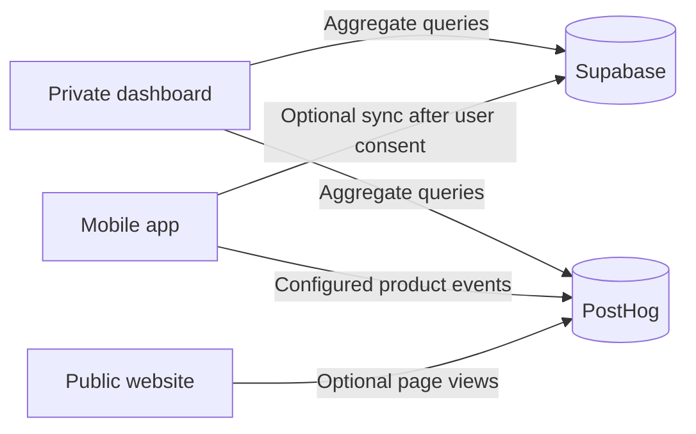

<p align="center">
  
</p>

<h1 align="center">DayKindle</h1>

<p align="center"><strong>Make room for change.</strong></p>

<p align="center">An open-source daily planner for goals, routines, and the things you want to do today.</p>

DayKindle helps you make a plan, keep your priorities in view, and adjust when the day changes. You can use the mobile app as a Guest and keep planner data on your device. Account sync starts only after you choose it in the app.

## What's in this repository

| Directory | Purpose | Stack |
| --- | --- | --- |
| [`mobile-app/`](mobile-app/README.md) | DayKindle for iOS and Android, with a web development target | Expo, React Native, TypeScript |
| [`marketing/`](marketing/README.md) | Public website, product information, and legal pages | TanStack Start, React, TypeScript |
| [`dashboard/`](dashboard/README.md) | Private product analytics for the team | Next.js, Supabase Auth, PostHog Query API |
| [`supabase/`](supabase/README.md) | Database migrations, project configuration, and Edge Functions | Supabase, PostgreSQL |

Each app has its own dependencies and commands. Run package-manager commands from that app's directory. Supabase CLI commands use the repository root so the CLI reads `supabase/config.toml`.

## How the apps connect



The dashboard shows aggregate counts and trends. It does not display individual planner entries. The app and website can send analytics when their public PostHog configuration is set.

## Run locally

Install a current Node.js release and npm. Each app has a lockfile; use `npm ci` for a reproducible install.

### Mobile app

```sh
cd mobile-app
cp .env.example .env.local
npm ci
npm run start
```

Use the Expo CLI to open the app. For native development builds, run `npm run ios` or `npm run android`. Native development requires the matching Apple or Android toolchain. Native backdrop blur requires a development build; Expo Go does not support it. See the [mobile app guide](mobile-app/README.md) for authentication and sync setup.

### Marketing site

```sh
cd marketing
cp .env.example .env.local
npm ci
npm run dev
```

The site runs at `http://localhost:3000`. Set `VITE_SITE_URL` to the production site origin before deployment. It sets canonical and social preview URLs, the sitemap origin, and the site's `WebSite` structured data. The favicon and social previews use the app logo.

### Private dashboard

```sh
cd dashboard
cp .env.example .env.local
npm ci
npm run dev
```

The dashboard runs at `http://localhost:3001`. It requires a confirmed Supabase Auth account with access recorded in `public.dashboard_admins`, plus server-side PostHog Query API credentials. See the [dashboard guide](dashboard/README.md) before configuring access.

### Supabase

Create a Supabase project, configure the app's publishable credentials, and follow the [Supabase setup guide](supabase/README.md). Run project commands from the repository root:

```sh
npx supabase link --project-ref <project-ref>
npx supabase db push
```

Keep `SUPABASE_SERVICE_ROLE_KEY` in the server-side Edge Function environment. Do not add it to the mobile app or any `EXPO_PUBLIC_*` variable. Keep `POSTHOG_PERSONAL_API_KEY` in the dashboard server environment.

## Useful commands

Run these from the matching app directory:

| App | Lint | Build or interface check |
| --- | --- | --- |
| Mobile | `npm run lint` | `npm run test:interface` |
| Marketing | `npm run lint` | `npm run build` |
| Dashboard | `npm run lint` | `npm run build` |

## Project docs

- [Product overview](PRODUCT.md)
- [Product requirements](PRODUCT_REQUIREMENTS.md)
- [Functional requirements](FUNCTIONAL_REQUIREMENTS.md)
- [Design and technical specification](DESIGN_AND_TECHNICAL_SPEC.md)
- [Web app layout](WEB-APPS.md)
- [Mobile app documentation](mobile-app/docs/)
- [Product design notes](docs/superpowers/specs/)

## Privacy and account sync

Guest planner data stays on the device. Signing in does not start sync; the app asks before syncing planner data to the account. Synced data is protected by account access policies but is not end-to-end encrypted. Review the [privacy policy](marketing/src/routes/privacy.tsx), the [terms](marketing/src/routes/terms.tsx), and the in-app notices before using a deployed service. Configure your own domain and Supabase project when running a fork or self-hosted copy.
