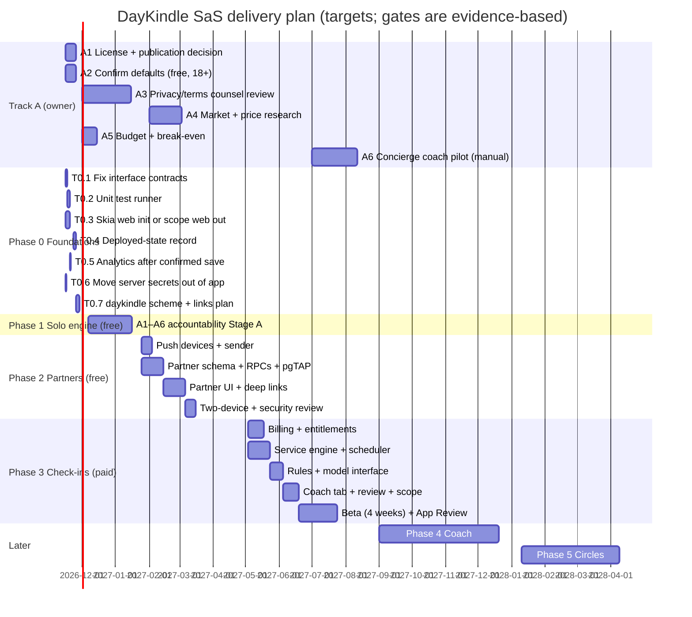

# SaS Next Steps — Implementation Plan

> **For agentic workers:** REQUIRED SUB-SKILL: use `superpowers:subagent-driven-development` (recommended) or `superpowers:executing-plans` to implement this plan task by task. Steps use checkbox (`- [ ]`) syntax for tracking. Do **not** run `git commit`, `git push`, `supabase db push`, function deploys, EAS builds or store submissions. Each task ends with a *commit proposal* that the owner approves and runs (`AGENTS.md`, "Git commit governance").

**Created:** 2026-11-13
**Last reviewed:** 2026-11-13
**Companion documents:** [Services-As-Software.md](Services-As-Software.md) (strategy, service catalog, pricing, competitor matrix), [accountability plan](docs/features/accountability/IMPLEMENTATION_PLAN.md) (Stages A and B), [services plan](docs/features/services/IMPLEMENTATION_PLAN.md) (Stage C), [full-scale audit](docs/audits/FULL_SCALE_AUDIT.md). This file is the execution plan.

**Goal:** Take DayKindle from a free, local-first planner to a Services-as-Software product. First close the defects that make a vendor-accountable service unsafe. Then finish the solo accountability engine and ship peer partners (both free). Then launch **DayKindle Check-ins** (AI-delivered, paid), then **DayKindle Coach** (human-reviewed, paid), then Circles.

**Architecture:**
- The device stays the source of truth for planner data. Partners and services read a **device-built, allow-listed summary**, never `planner_entities`.
- Supabase stays the single backend. A **service engine** is a set of Postgres tables plus a SQL state machine.
- Background work runs on pg_cron and pg_net (with Vault secrets), and on Supabase Queues (pgmq) for check-ins. Edge Functions execute it.
- Numbers, pace and adjustment choices are deterministic pure functions with unit tests. A model only rewrites text.
- Store billing writes an `entitlements` table that the app and functions read.

**Tech stack (current, Verified 2026-11-13 from package manifests):**

| Surface | Stack |
| --- | --- |
| Mobile (`mobile-app/`) | Expo ~57.0.25, React Native 0.86.3, React 19.2.3, Expo Router ~57.0.23, Expo SQLite and Notifications, Reanimated 4, Skia, Supabase JS ^2.117.2, PostHog RN, TypeScript ~6.0.3. Tests: `node --test scripts/test-interface.cjs` only. |
| Dashboard (`dashboard/`) | Next.js 16.4.0, React 19.3.0, Supabase SSR/JS, Recharts. No tests. |
| Marketing (`marketing/`) | TanStack Start 1.168.60, Vite 8, Tailwind 4, React ^19.2.0. No tests. |
| Backend (`supabase/`) | Postgres and RLS (5 migrations), Deno Edge Functions `daily-plan` and `delete-account`. No database tests. |

## Global constraints

These apply to every task:
- Follow `AGENTS.md`. Inspect `git status` before editing and preserve unrelated work. App commands run inside each app directory; Supabase CLI runs from the repository root. There is no root build or test.
- Schema changes go only in timestamped files under `supabase/migrations/`, and must be additive (expand, migrate, contract). Each new table ships with RLS, `revoke all` from client roles, and `security definer` write functions with `set search_path = ''` in the same migration, matching `20261005151602_planner_entity_sync.sql`.
- Never put service-role keys, PostHog personal API keys, model keys, store webhook secrets or OAuth secrets in `EXPO_PUBLIC_*` variables, a client bundle, `.env.example` or documentation.
- Planner notes, goals, check-ins, commitments and reflections are personal data. Analytics events carry categories and counts only. The internal dashboard shows aggregates only.
- Guest use stays fully functional. Nothing free today becomes paid. Cloud sync is never enabled silently, and no service requires it.
- A model never computes a count, pace, risk or adjustment choice. Models reword text only, and every model path has a rules-only fallback.
- No shame wording, streak-loss framing, money stakes or leaderboards (PRD §34, §36). Copy promises delivery, never outcomes.
- New mobile UI uses the existing theme hooks (`use-themed-styles.ts`), `SquircleCard`/`SquircleSurface`, `AppTextInput`, `AppFeedback`, `NativeActionButton` and the Tray organism. No new hex literals; both Refined and Expressive styles and reduced motion must work.
- Every new `security definer` function checks the caller **as its first statement**. Every Edge Function validates the bearer token before any service-role call, matching `delete-account`.
- Update the relevant `docs/` pages in the same change, marked with a review date and evidence level.

---

## 0. How this plan is scoped, and why

| Decision | Choice | Reason | Trade-off accepted |
| --- | --- | --- | --- |
| Level of detail | **Phase 0 is written to code level. Phases 1 and 2 point at the code-level [accountability plan](docs/features/accountability/IMPLEMENTATION_PLAN.md). Phase 3 is at milestone level with design in the [services plan](docs/features/services/IMPLEMENTATION_PLAN.md). Phases 4–5 are milestones only.** | Phase 0–2 are fully knowable from today's source. Phase 3+ depends on the billing-library decision, store review, price research and pilot data that do not exist yet (YAGNI). | Later phases need a planning pass before execution; this plan schedules it. |
| Order | **Foundations, then free accountability, then paid AI, then paid human** | A service DayKindle is accountable for inherits every defect underneath it. Free partners prove the sharing model and create the audience before anyone pays. | About 6 months pass before revenue. Track A (license, legal, research) runs in parallel. |
| AI before human | Check-ins (5.99) before Coach (69) | Tests willingness to pay cheaply. Coach costs depend on a manual pilot that should run first. | Coach demand is unproven until Phase 4. |
| Billing library | Decide in T3.1, not now | The choice only matters once a paid product exists. | None now. |

---

## 1. What is left, and what changed since `Services-As-Software.md`

### 1.1 Items left open in the strategy document

| Item | Where it is handled |
| --- | --- |
| Repository publication and license (§15 Q1–Q2) | Track A, task A1 (new finding below) |
| Defaults in §2 (free scope, 18+, no stakes) | Track A, task A2 |
| Markets and regional pricing (§15 Q4) | Track A, task A4 |
| Budget and break-even (§15 Q5) | Track A, task A5 |
| Concierge pilot owner (§15 Q6) | Track A, task A6 |
| Six audit blockers (§4) | Phase 0, tasks T0.1–T0.7 |
| Solo engine | Phase 1 (accountability Stage A) |
| Partners and remote push | Phase 2 (accountability Stage B) |
| Service engine, billing, Coach tab | Phase 3 |
| Feature docs | Every task's "Docs" step, plus §9 |

### 1.2 New findings from this planning pass

Each was checked on 2026-11-13.

1. **The GitHub repository is public and has no project license (Verified with `gh repo view`).** `visibility: PUBLIC`, `licenseInfo: null`. The only license file is `mobile-app/LICENSE`, the unmodified **Expo template MIT license, copyright 650 Industries (Expo)**. It does not license DayKindle's own code. `Services-As-Software.md` and this file are untracked; committing them publishes pricing, margins and positioning. Decide before the first commit (A1).
2. **Interface tests: 8 of 11 pass, 3 fail (Verified, `npm run test:interface`).** Failing: case 6 (contrast test reads `home-screen.tsx` but styles moved to `home-screen-styles.ts`), case 10 (splash opacity contract), case 11 (squircle ratio 0.1 expected, source uses 0.14). The suite grew from 10 to 11 cases since the 2026-10-27 audit; the same three fail.
3. **All other static checks pass (Verified).** Mobile `tsc --noEmit` and `expo lint`, dashboard `tsc` and `eslint`, marketing `tsc` and `eslint`: all exit 0.
4. **`mobile-app/.env` holds two server credentials (Verified by variable name only; values not read).** `expo lint` printed the loaded names: `POSTHOG_PERSONAL_API_KEY` and `SUPASBASE_SERVICE_ROLE_KEY` (misspelled). Neither has the `EXPO_PUBLIC_` prefix, so Expo does not inline them, and `.env` is gitignored. They still violate `AGENTS.md` ("Never put service-role credentials … in a client bundle") in spirit, because any future `EXPO_PUBLIC_` rename or a `process.env` read in app code would ship them. Move them out of the app directory (T0.6).
5. **Schemes:** `app.json` declares `dayweave` and `daymark` only. Partner invites and service notifications need a `daykindle` scheme plus universal links (T0.7).
6. **No scheduled-job infrastructure exists.** None of the 5 migrations uses pg_cron, pg_net, Vault or pgmq. Phase 2 introduces the first cron job; record it in `supabase/README.md`.
7. **Node 22.23.4 runs `.ts` files directly** (type stripping), so a `node --test` unit runner needs no new dependency for React-Native-free modules (Verified 2026-11-12 in the accountability plan; Node version re-checked 2026-11-13).
8. **Session schema is version 9** (`home-session.tsx:73`). Commitment outcomes bump it to 10 (accountability A2).
9. **Completion analytics still fires before confirmed save** (`home-screen.tsx:574`, TD-14).

---

## 2. Sequencing and critical path



**Critical path:** T0.2 unit runner, then accountability Stage A, then push and partner schema, then the service engine, then the beta, then App Review. Billing (T3.1) can start as soon as A1 settles the license, because a paid app with an unclear license is the one thing that cannot be fixed after launch.

**Effort assumption:** one to two engineers. Durations are working-day estimates, not commitments.

---

## 3. Track A — owner and business tasks (non-code, parallel)

### A1. License and publication decision, weeks 1–2

**Why:** the repository is public with no project license (finding 1). The code is therefore "all rights reserved" while the README says "open-source". Strategy files are about to be committed into a public repository.

- [ ] Decide where `Services-As-Software.md` and `SaS-Next-Steps.md` live: this public repository, a private repository, or a private docs space.
- [ ] Choose a license: MIT or Apache-2.0 (maximum community use; the moat is coaches, operations and brand), or AGPL-3.0 for server code (hosted forks must publish changes). Consider a separate trademark notice for the DayKindle name and logo, as CediWise does with `TRADEMARK.md`.
- [ ] Replace or remove `mobile-app/LICENSE` (Expo template) so it does not appear to license DayKindle.
- [ ] Record the decision in `README.md`.

**Gate:** before any paid feature and before committing strategy files.

### A2. Confirm the §2 defaults, week 1–2

- [ ] Everything shipped today stays free, including sync and partners.
- [ ] Paid services and partners are 18+ until a teen and guardian policy exists.
- [ ] No money stakes, ever.
- [ ] Record confirmed answers in `Services-As-Software.md` §2 and change "proposed default" to "confirmed (date)".

### A3. Privacy policy and terms review, December–January

**Why:** partners add cross-user sharing; services add a model provider, a billing processor and, later, coaches. The current `marketing/src/routes/privacy.tsx` and `terms.tsx` describe none of these.

- [ ] Have counsel in the main user markets review: sharing with other people, model processing (provider, region, retention, no training), billing processor, coach access, minors, deletion.
- [ ] Draft store privacy labels (App Store privacy details, Play Data safety) for Phase 2 and Phase 3 separately.

**Gate:** Phase 2 release (sharing) and Phase 3 release (model, billing).

### A4. Market and price research, February

- [ ] From aggregate analytics, list the top markets by active users. Set regional store price tiers.
- [ ] Run the Van Westendorp survey card ([strategy §8.6](Services-As-Software.md)) with at least 100 responses from Free users with 4+ weeks of activity.
- [ ] Re-check competitor prices on vendor sites (the third-party-sourced rows in strategy §5.2).

### A5. Budget and break-even, December

- [ ] Set the fixed monthly cost for Phases 0–3. Compute break-even subscribers with strategy §8.3.

### A6. Concierge coach pilot, July–August 2027

- [ ] Recruit 10–15 Check-ins subscribers. The founder or one coach follows up by hand on shared items for 6 weeks using Phase 2 partner tools.
- [ ] Measure coach minutes per client-week, median follow-up hours and renewal intent.

**Gate:** Phase 4 build starts only if minutes ≤ 15 per client-week and median follow-up ≤ 24 hours.

---

## 4. Phase 0 — Foundations (code level)

**Exit gate:** `npm run test:interface` and `npm run test:unit` green; deployed-state record written; server secrets out of `mobile-app/.env`; web either renders planner routes or is explicitly scoped out of service surfaces; the license decision committed.

### T0.1 Repair the three stale interface contracts

**Files:** `mobile-app/scripts/test-interface.cjs` (modify).

- [ ] **Case 6:** change the contrast test to read selected-state and primary-label styles from `src/features/home/home-screen-styles.ts`, where they now live. Keep the existing contrast thresholds.
- [ ] **Case 10:** confirm the intended splash opacity with the owner. Current source is `opacity: 1 - exitProgress`; the test expects `revealProgress * (1 - exitProgress)`. Update whichever side is wrong. Keep the "at least two seconds" and reduced-motion assertions.
- [ ] **Case 11:** confirm the intended squircle depth (source `0.14`, test `0.1`). If 0.14 is intended, rename the test ("fourteen-percent") and assert against the source constant rather than a duplicated literal, so the next change fails only once.
- [ ] Run `npm run test:interface` from `mobile-app/`. Expected: 11 of 11 pass.

**Docs:** update `docs/audits/TEST_COVERAGE.md` with the date and result.
**Commit proposal:** `test(mobile): align interface contracts with current styles`

### T0.2 Add a unit-test runner for pure modules

**Files:** `mobile-app/package.json` (modify), `mobile-app/src/features/home/occurrences.test.ts` (new).

- [ ] Add the script: `"test:unit": "node --test --experimental-strip-types \"src/**/*.test.ts\""`. On Node 22.23.4 type stripping is enabled by default; keep the flag so older Node 22 releases behave the same.
- [ ] Confirm `occurrences.ts` has no runtime imports from React Native. If it does, use `import type` or move the pure function out first.
- [ ] First tests for `reconcileOverdue()`: a `planned` entry dated yesterday becomes `missed` with one status-history event; a `completed` entry is unchanged; an entry dated today is unchanged; running twice adds no second event.
- [ ] Run `npm run test:unit`. Expected: all pass.

**Docs:** `docs/audits/TEST_COVERAGE.md`.
**Commit proposal:** `test(mobile): add node unit runner for pure planner rules`

### T0.3 Skia web initialization, or scope web out

**Files:** `mobile-app/src/app/_layout.tsx` or a new `mobile-app/src/app/_layout.web.tsx` (modify/new).

- [ ] Wrap the web root in Skia's `WithSkiaWeb` / `LoadSkiaWeb` so `global.CanvasKit` exists before any Skia surface mounts. Serve `canvaskit.wasm` from `public/` so it works with external requests blocked.
- [ ] Repeat the isolated browser route smoke from `docs/audits/TEST_COVERAGE.md` (13 routes, 4 widths). Expected: no `PathBuilder` or `Typeface` errors; Today, Goals, Progress and Profile render text.
- [ ] If it cannot be fixed within the time box, record "web planner unsupported" in `docs/features/FEATURE_INVENTORY.md` and keep all service surfaces native-only.

**Commit proposal:** `fix(mobile): initialize Skia before web planner routes render`

### T0.4 Record the deployed Supabase state (read-only)

- [ ] With an authorized read-only role on the target project: `supabase migration list` against the linked project; list deployed functions and versions; dump RLS policies for `planner_entities`, `planner_snapshots`, `daily_plan_catalog`, `dashboard_admins`.
- [ ] On a **disposable** project or local stack: create a user, sync, call `delete-account`, assert zero rows remain for that user in every user-keyed table.
- [ ] Write the result to `docs/audits/SECURITY_AUDIT.md` with the date, project reference and what was not checked.

**Commit proposal:** `docs(supabase): record deployed migration and policy state`

### T0.5 Emit completion analytics after the confirmed save

**Files:** `mobile-app/src/features/home/home-screen.tsx` (modify near line 574).

- [ ] Move `posthog?.capture('planner_item_completion_toggled', …)` after `await confirmLocalSave()` resolves, matching the check-in and reflection handlers. On rejection, do not capture.
- [ ] Manually force a write failure (temporary throw in `home-storage.ts`, reverted) and confirm no event is captured and the retry path still shows.

**Commit proposal:** `fix(mobile): count completions only after local save confirms`

### T0.6 Move server credentials out of the app directory

- [ ] Delete `POSTHOG_PERSONAL_API_KEY` and `SUPASBASE_SERVICE_ROLE_KEY` from `mobile-app/.env`. They belong in `dashboard/.env.local` (PostHog) and Supabase secrets (service role).
- [ ] Rotate both if there is any chance the file was shared, committed elsewhere or synced to a cloud drive.
- [ ] `grep -rn "process.env" mobile-app/src` and confirm only `EXPO_PUBLIC_*` names are read.

**No commit** (`.env` is gitignored). Record completion in `docs/audits/SECURITY_AUDIT.md`.

### T0.7 Add the `daykindle` scheme and plan universal links

**Files:** `mobile-app/app.json` (modify).

- [ ] Add `"daykindle"` as the first scheme; keep `dayweave` and `daymark` for existing installs.
- [ ] Decide the marketing domain path for links (`/partner`, `/s/<runId>`). Plan `apple-app-site-association` and `assetlinks.json` routes in `marketing/`, plus `ios.associatedDomains` and Android `intentFilters`. Implement in Phase 2 with the invite flow.
- [ ] Note in the release checklist that a native rebuild is required.

**Commit proposal:** `chore(mobile): register daykindle URL scheme`

---

## 5. Phase 1 — Solo engine completion (free)

**Source of truth:** [accountability plan §3, Stage A](docs/features/accountability/IMPLEMENTATION_PLAN.md). Tasks, files and tests are written there to code level.

| Task | Summary | Depends on |
| --- | --- | --- |
| T1.1 = A1 | Extract `features/accountability/accountability.ts` with `node --test` coverage; replace inline `commitmentMetrics` | T0.2 |
| T1.2 = A2 | Commitment `status` and `closedAt`, schema 9 → 10, close-out UI ("I kept it" / "Not this time" / "Let it go") | T1.1 |
| T1.3 = A3 | Pace line on the commitment card | T1.1 |
| T1.4 = A4 | Reason-based recommendation candidate (ACC-006) | T1.1 |
| T1.5 = A5 | Intensity setting in Profile (Gentle, Balanced, Direct) | T1.1 |
| T1.6 = A6 | Weekly reflection prefill with counts | T1.1 |

**Exit gate:** unit tests for every rule; no new lint, typecheck or interface failures; a simulator walk-through of miss, reason, recovery, pace and close-out in both visual styles and with reduced motion; `commitment_closed` visible in aggregate analytics; [accountability current state](docs/features/accountability/CURRENT_STATE.md) updated.

---

## 6. Phase 2 — Accountability partners (free)

**Source of truth:** [accountability plan §4, Stage B](docs/features/accountability/IMPLEMENTATION_PLAN.md).

| Task | Summary | Depends on |
| --- | --- | --- |
| T2.1 = B3/B4 | Migration `<ts>_accountability_partners.sql`: settings, partnerships, grants, projections, nudges, `push_devices`; RPCs | T0.4 |
| T2.2 = B9 | First pgTAP suite `supabase/tests/accountability_partners.test.sql` | T2.1 |
| T2.3 = B5 | `accountability-nudge` Edge Function, pg_cron sweeper, Vault secret, device registration and revocation | T2.1 |
| T2.4 = B6 | `accountability-sharing.ts` device publisher | T1.1, T2.1 |
| T2.5 = B7 | Partner routes, invite deep links, universal links | T0.7, T2.4 |
| T2.6 = B8 | Content-free partner analytics | T2.5 |

**Exit gate:** pgTAP green locally; written security review of the cross-user path; push delivered to a physical iOS and Android device; two-device walk-through; deletion cascade verified on a disposable project; privacy policy and store labels updated (A3); 4 weeks of aggregate data comparing recovery-after-miss with and without a partner. Only then change `mobile-app/PRODUCT.md`'s "do not claim … social accountability".

---

## 7. Phase 3 — DayKindle Check-ins (paid, milestone level)

**Design:** [services plan](docs/features/services/IMPLEMENTATION_PLAN.md). Write a code-level plan for this phase when Phase 2 passes its gate.

| Task | Deliverable | Decision or check needed first |
| --- | --- | --- |
| T3.1 | Billing library choice; products in App Store Connect and Play Console; Small Business Program enrollment | Native StoreKit/Play Billing vs a subscription SDK (services plan §8). **Needs Validation:** current SDK pricing and Expo SDK 57 compatibility. |
| T3.2 | `<ts>_service_engine.sql` (entitlements, store events, engagements, runs, events, summaries, results, outcomes, credits, AI cost log) with pgTAP for the state machine | Services plan §6 |
| T3.3 | `_shared/ai/` with one provider, guardrails and cost logging | Provider with no training on inputs and a documented region (**Needs Validation**) |
| T3.4 | `store-webhook`, `service-scheduler`, `service-summary`, `service-checkin-worker`, `service-credit` | pgmq enabled on the project |
| T3.5 | `service-summary.ts` and `service-rules.ts` on device, with drift test against the Deno copy | T1.1 |
| T3.6 | Coach tab (free rules-only and paid), scope screen, review, replan diff, Profile → Services | Design review against `PRODUCT.md` anti-references |
| T3.7 | Credits through store renewal extension, or the extra-outcome fallback | **Needs Validation:** App Store Server API and Play Developer API extension limits |
| T3.8 | Dashboard **Services** KPI page, aggregates only | Strategy §9 |
| T3.9 | Paywall price experiment (3.99 vs 5.99) and founding offer | A4 |

**Exit gate:** on-time delivery ≥ 95% over a 4-week TestFlight / internal-track beta; credits exercised in the store sandbox; App Review approval with the scope text; privacy labels updated; harm-signal KPIs flat or falling during the beta.

---

## 8. Phases 4–5 (milestones)

**Phase 4 — DayKindle Coach.** Gate: A6 pilot thresholds met. Then: `role = 'coach'` on partnerships, the coach app or mode (never the dashboard), draft-and-edit messaging with minute tracking, `coach_access_log`, coach agreement and training, a safety protocol reviewed by a qualified professional, H1–H3 products. Exit: median follow-up ≤ 24 h, ≤ 15 coach minutes per client-week, zero protocol breaches, legal review of coach terms.

**Phase 5 — Circles and organizations.** Groups of 3–8 with weekly summaries built only from what members shared; organization pricing; a host view with aggregates. Billing route depends on App Store guideline 3.1.3 for group services (**Needs Validation**). No rankings.

---

## 9. Documentation work in every phase

| When | Update |
| --- | --- |
| Each task | The feature's `CURRENT_STATE.md` with date and evidence level |
| Phase 0 | `docs/audits/TEST_COVERAGE.md`, `SECURITY_AUDIT.md`, `FULL_SCALE_AUDIT.md`; `docs/architecture/TECHNICAL_DEBT.md` (close TD-04, TD-14, TD-15 when fixed) |
| Phase 2 | `SYSTEM_OVERVIEW.md`, `DATA_FLOW.md`, `MODULE_MAP.md` for the sharing boundary and first cron job; `supabase/README.md` for cron and Vault; `FEATURE_INVENTORY.md` partners and push rows |
| Phase 3 | Same architecture pages for the service engine, store webhooks and model calls; `docs/features/services/CURRENT_STATE.md`; privacy and terms |
| Phase 4 | Coach surface in `SYSTEM_OVERVIEW.md`; `PRODUCT.md` coaching line after the gate |

---

## 10. Commit proposal template

Every task ends with a proposal in this form. Nothing is staged until the owner approves.

```text
Intent: <one sentence>
Files to stage:
  - <path> — <what changed>
Message:
  <type>(<scope>): <summary>

  <body: why, and evidence collected>

  Co-Authored-By: <as configured>
```

Types: `feat`, `fix`, `refactor`, `style`, `docs`, `test`, `chore`.

---

## 11. Sources

Internal facts come from the working tree on 2026-11-13: package manifests, `app.json`, `home-session.tsx`, `home-screen.tsx`, `notification-service.ts`, the five migrations, the two Edge Functions, and these local runs: mobile `npm run test:interface` (8/11 pass), mobile `npx tsc --noEmit` and `npm run lint` (pass), dashboard and marketing `npx tsc --noEmit` and lint (pass), and `gh repo view teebhagg/DayKindle --json visibility,licenseInfo`. External platform and price facts are cited in [Services-As-Software.md §16](Services-As-Software.md). No build, store submission, database query, provider call or deployment was performed.
