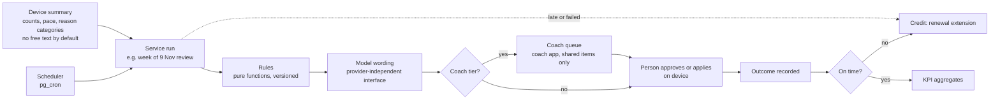

# DayKindle as Services-as-Software

**Created:** 2026-11-12
**Last reviewed:** 2026-11-12
**Status:** Proposal and upgrade plan. Nothing in this document is implemented, priced live, store-approved, or legally cleared. The owner decisions in §2 are **proposed defaults** that still need confirmation.
**Evidence labels:** same as [the system overview](docs/architecture/SYSTEM_OVERVIEW.md).

- **Verified** means the item was read in the current working tree, run as a local check, or read on an official source on the date shown.
- **Inferred** means a reasoned consequence that has not been measured.
- **Needs Validation** means a legal opinion, a store or provider check, a device test, or a live measurement is still required.

**Companion documents:** [SaS-Next-Steps.md](SaS-Next-Steps.md) (execution plan), [accountability feature](docs/features/accountability/IMPLEMENTATION_PLAN.md), [services feature](docs/features/services/IMPLEMENTATION_PLAN.md), [full-scale audit](docs/audits/FULL_SCALE_AUDIT.md).

> **Publication note.** The GitHub repository `teebhagg/DayKindle` is **public** (Verified with `gh repo view`, 2026-11-13). Committing this file publishes pricing, margins and competitor positioning. Decide whether strategy documents belong in the public repository before committing it (open question 1, §15; SaS-Next-Steps task A1).

---

## 1. Executive summary

DayKindle today is a **tool**. A person plans goals, tasks, habits and routines, records what happened, and uses the recovery flow when a day goes wrong. The person does all of the accountability work: noticing misses, choosing a reason, picking a recovery, closing a commitment, and reviewing the week.

Services-as-Software (SaS) turns part of that work into a **delivered service**. DayKindle would sell finished accountability work, not access to screens. Examples: a weekly review that is ready on Monday, check-ins that arrive when a commitment needs them, a rebuilt plan after a hard week, and, later, a human accountability coach who follows up on every miss within a day. Software and a language model do most of that work. A human coach does the part that needs a person. The customer pays for work delivered on schedule, with credits when it is not delivered.

There is one firm boundary. DayKindle can be accountable for **delivering the accountability service**: check-ins on time, reviews ready, follow-ups done. It must never promise **life outcomes** such as weight lost, habits formed or goals reached. `PRODUCT.md` lists "guaranteed outcomes" as an anti-reference, and no planner can honestly guarantee behavior change.

**Why this fits DayKindle specifically:**

1. The product requirements already describe DayKindle as "both a planning tool and an accountability partner" (PRD §3). The service is that sentence made real.
2. The hardest part of a service, the accountability engine, is mostly built and works offline: miss detection, 11 reasons, 7 recovery actions and commitment tracking (see [accountability current state](docs/features/accountability/CURRENT_STATE.md)).
3. Peer partners, which the requirements want anyway (PART-001/002), give the **same sharing infrastructure** a human coach needs. One permission-and-preview system serves friends, coaches and DayKindle itself.
4. The market has a gap. Commitment tools use money penalties (Beeminder, stickK). Human coaching costs USD 60–200 a month (Coach.me, GoalsWon, Commit Action). Planners leave the accountability to you. Nobody offers **compassionate, recovery-first accountability** as an affordable service.

**Recommended path:** six phases from November 2026 to 2028.

1. **Phase 0, Foundations.** Repair the known defects, establish a unit-test runner, choose a license, and register push tokens server-side.
2. **Phase 1, Solo engine completion (free).** Commitment outcomes and pace, reason patterns, intensity setting, weekly summary.
3. **Phase 2, Accountability partners (free).** Invite-only partners, per-item sharing with previews, preset nudges, remote push.
4. **Phase 3, DayKindle Check-ins (paid, AI-delivered).** A Coach tab with the weekly review, commitment check-ins and recovery replans.
5. **Phase 4, DayKindle Coach (paid, human-reviewed).** A human coach working through the same sharing model, with AI drafting and a safety protocol.
6. **Phase 5, Circles and organizations.** Small-group accountability for study groups, faith groups and teams.

Everything DayKindle offers today stays free, including planner sync. Paid tiers add **done-for-you work**, never a paywall on existing features. App Store guideline 3.1.2 also says not to take away functionality existing users already have.

---

## 2. Decisions (proposed defaults, owner confirmation required)

No owner interview has been recorded for DayKindle. These defaults keep the plan consistent with `PRODUCT.md`, the PRD and `AGENTS.md`. Change any of them and the dependent sections change.

| Decision | Proposed default | Consequence for this plan |
| --- | --- | --- |
| First customer | **Individuals** (the PRD's primary persona: a self-directed adult who "struggles with consistency" and "wants accountability") | Groups and organizations wait for Phase 5. |
| What stays free | **Everything shipped today, plus peer partners** | Paid value must come from delivered work (AI and human), not locked features. |
| Service sequence | **AI-delivered first, human coach second** | The AI tier tests willingness to pay at a low price before taking on coach operating costs. |
| Pricing model | **Subscription with delivery guarantees (credits when an outcome is missed), plus optional per-outcome purchases** such as an extra coach call | Fits store billing and consumer budgets. Pure per-outcome metering is confusing for individuals (§8.1). |
| Money stakes | **Excluded permanently** | PRD §34 lists monetary punishments as a non-goal. It is also the clearest difference from Beeminder and stickK. |
| Age | **18+ for partners and paid services** until a teen and guardian policy exists | The app itself remains 13+. |
| Channel | **In-app plus remote push** | No SMS, email-first or WhatsApp channel until Phase 5. |
| Currency | **USD list prices with store regional price tiers** | Price research (§8.6) must cover the markets where current users are. |
| Data for AI | **Device-built summaries; planner sync not required** | Matches the "share without syncing" partner design and keeps reflection text out of AI unless the user opts in per feature. |

**Still open:** see §15.

---

## 3. What Services-as-Software means for DayKindle

| Dimension | Today: free planner (software) | Target: Services-as-Software |
| --- | --- | --- |
| What the person gets | Screens to plan, record and recover | Finished accountability work: "Your week is reviewed", "Your commitment was checked in on twice and closed", "Your coach followed up on Tuesday's miss" |
| Who does the work | The person notices misses, picks reasons, decides next steps, writes the review | Rules and a model prepare it; the person approves; a coach handles what needs judgment and warmth |
| Who carries responsibility | The person | DayKindle is responsible for **delivering the service on schedule**, within a written scope. The person stays responsible for their own life choices. |
| Pricing unit | Free | Monthly subscription with included outcomes; credits for missed deliveries; optional per-outcome purchases |
| Success measure | Activation, retention | On-time delivery, recovery-after-miss rate, commitment close-out rate, coach response time, harm signals, gross margin |
| Core system | Local planner and sync | A **service engine**: engagements, then scheduled runs, then rules, then model wording, then optional coach review, then user approval, then outcome, then credit or billing record |

The underlying idea comes from Foundation Capital's framing: software leaves the customer responsible for using the tool, whereas services make the vendor responsible for the result, and AI lets that service run at software-like margins [S1]. For DayKindle the "result" is defined narrowly as **the accountability work**, never the person's behavior.

---

## 4. Current-state baseline (Verified from the working tree, 2026-11-12)

The SaS layer would build on these assets.

| Asset | Where | Relevance to SaS |
| --- | --- | --- |
| Accountability engine | `features/home/occurrences.ts`, `home-screen.tsx`, `use-home-screen-model.ts` | Miss detection, 11 reasons, 7 recovery actions, repeated-reason suggestion and commitment progress. This is the raw material of every service. **Gaps:** no commitment outcome or risk, the intensity setting is unused, and reasons do not feed recommendations. |
| Deterministic recommendations | `recommendationCandidates` in `home-screen.tsx` | Weekday miss rate, reschedule pattern, overload, high-success day, return after inactivity, goal linking. Each has evidence text and a one-tap apply. This becomes the rules layer of the weekly review. |
| Local-first storage | `home-storage.ts` (SQLite), `home-storage.web.ts` | Services must work when the device is offline and must not require planner sync. |
| Consent-gated sync | `account-provider.tsx`, `planner_entities`, `sync_planner_mutations` | Strictly owner-scoped. Partners and coaches must **not** read it; they use a separate projection (see the accountability plan). |
| Server-managed content | `daily-plan` Edge Function and `daily_plan_catalog` (migration 2026-10-30) | The first admin-editable, revision-checked server content. It is the pattern for service-managed prompt and template content. |
| Push readiness | `registerPushToken()` | Obtains an Expo token. **No server storage or sender exists.** Every service depends on remote push. |
| Dashboard | `dashboard/`, `dashboard_admins` | Aggregate service KPIs belong here. **Constraint:** `AGENTS.md` forbids planner content in internal dashboard views, so coaches cannot work in this dashboard. |
| Analytics | PostHog events with categorical properties | Service KPIs can reuse the content-free event style. |
| AI | None in source. Routine "AI import" is copy-and-paste with an external assistant. | The service needs the provider-independent AI interface that FR AI-001–005 already require (server-side keys, swappable provider). |
| Billing | None in source | Store billing, entitlements and webhooks are all new. |
| License | **No project license.** The only license file, `mobile-app/LICENSE`, is the Expo template's MIT license with Expo's copyright, and GitHub detects no license for the public repository (2026-11-13). The README says "open-source". | It must be decided before any paid feature. See §12 and §15. |

**Audit items that block SaS** (details in [full-scale audit](docs/audits/FULL_SCALE_AUDIT.md)):

1. Three failing interface-test assertions (stale contracts), and no unit-test runner for domain logic (TD-04).
2. Web planner routes hydrate blank because Skia web is not initialized (TD-15). This matters for any web pricing or checkout page that reuses app components.
3. Deployed Supabase state is unverified, including migrations, functions, RLS and the deletion cascade (TD-05).
4. No server push path (TD-10).
5. Completion analytics fires before the local save is confirmed (TD-14). Service KPIs must count durable events only.
6. The interface between legacy snapshot sync and entity sync is untested (TD-03). Services read device state that sync may replace.

A service DayKindle is accountable for cannot sit on unverified deletion, untested state transitions, or push that does not exist. Phase 0 fixes these.

---

## 5. Market and platform research

### 5.1 Platform and policy facts that shape the service design

| Fact | Source | Design consequence |
| --- | --- | --- |
| Apps may use non-IAP payment only for **real-time person-to-person** services between two individuals (tutoring, fitness training, consultations). One-to-few and one-to-many real-time services must use in-app purchase. | App Store Review Guidelines 3.1.3(d) [S9] | The AI tier must use IAP. Asynchronous coach messaging is not clearly "real-time", so plan for IAP for the coach tier too (**Needs Validation** with App Review). Group circles must use IAP if sold in the app. |
| Apple's subscription commission is 15% for Small Business Program members from the first billing cycle. Otherwise it is 30% in the first year and 15% after one year of paid service. | Apple Small Business Program and subscriptions pages [S10][S11] | Model 15% store fees and enroll in the Small Business Program before launch. |
| Google Play auto-renewing subscriptions: 10% plus a 5% billing fee in the US, UK, EEA, Australia and Japan; 15% in other markets. | Google Play service fees [S12] | Model 15% on Android. |
| Subscriptions must clearly describe what the user gets before purchase, and must not require extra tasks to receive what was paid for. | App Store Review Guidelines 3.1.2 [S9] | Each service tier needs an explicit, countable scope ("4 weekly reviews, check-ins on up to 3 commitments…"). This is the same discipline as defining "done". |
| Changing to a subscription model must not take away primary functionality existing users already have. | App Store Review Guidelines 3.1.2 [S9] | Confirms the default: nothing that is free today becomes paid. |
| The app is offered to people aged 13 and older. | `PRODUCT.md` (Verified) | Purchases by minors, contact between adults and minors, and AI processing of minors' reflections each need a policy. The default restricts paid services and partners to 18+. |
| Guideline 5.1 privacy rules and store data-safety labels apply to any new data collection. | General store policy (**Needs Validation**: re-read 5.1.1 and Play Data safety before Phase 2) | Partner sharing, coach access and AI processing must be declared in store privacy labels. |

### 5.2 Price anchors (checked 2026-11-12, USD)

| Category | Product | Published price | Source |
| --- | --- | --- | --- |
| Commitment contracts | Beeminder | Core free (charges only on derailment, from $5); Infinibee $8/mo; Bee Plus $16/mo; Beemium $81/mo; 14% off yearly | [S2][S3] |
| | stickK | Free to create; charges stakes on reported failure. The published fee terms conflict between its help center and FAQ, so no fee is quoted here. | [S8] |
| Live co-working | Focusmate | Free for 3 sessions a week; Plus $12/mo, or $8/mo billed yearly | [S4] |
| Human habit coaching | Coach.me | Habit coaching $25/week or $87/month (daily private chat) | [S5] |
| | GoalsWon | $90/mo, or $60/mo billed yearly; daily review plus monthly video call (third-party compilation) | [S6] |
| | Boss as a Service | $25 / $100 / $200 per month (third-party compilation) | [S6] |
| | Commit Action | $199/mo for a weekly 20-minute call plus messaging (third-party compilation) | [S6] |
| AI coaching | Rocky.ai | Free, or $9.99/mo (third-party compilation) | [S6] |
| Behavior-change programs | Noom Weight | $70 month-to-month; "as low as $17 a month" on an annual plan; 1:1 coach is a separate add-on | [S7][S13] |

Rows marked "third-party compilation" come from a competitor's blog, not the vendor's own page. Re-check them on each vendor site before using them in public copy.

---

## 6. Competitor matrix

**Market landscape** (vendor claims; none were tested):

| Competitor | Model | Accountability mechanism | Tone |
| --- | --- | --- | --- |
| Beeminder | Freemium plus pledges | Money charged on derailment; data integrations | Strict, quantified |
| stickK | Free plus stakes | Commitment contract, referee, supporters | Contractual |
| Focusmate | Freemium sessions | Live video co-working with a stranger | Social presence |
| Coach.me | Free tracker plus paid coaches | Human coach via daily chat | Personal |
| GoalsWon / Commit Action | Monthly human coaching | Dedicated coach, daily review, calls | Personal, premium |
| AI coaching apps (Rocky.ai and others) | Subscription | Chat-based AI coach | Conversational |
| Habit trackers (Habitica, Streaks-style apps) | Freemium | Streaks, games, social | Gamified |
| Planners (Todoist, Structured-style apps) | Freemium | Reminders only | Neutral |

**Feature comparison:**

| Capability | DayKindle today | DayKindle SaS target | Beeminder | stickK | Focusmate | Coach.me | Human coach services |
| --- | --- | --- | --- | --- | --- | --- | --- |
| Goals, routines, tasks and habits in one planner | Yes | Yes | Partial | No | No | Partial | No |
| Missed-action reasons and recovery choices | Yes | Yes | No | No | No | Partial (coach) | Partial |
| Works offline, no account needed | Yes | Yes (free tier) | No | No | No | No | No |
| Peer partners with per-item permissions | No | Yes (Phase 2) | No | Referee/supporters | No | Community | No |
| Money stakes | No | **No, by design** | Yes | Yes | No | No | No |
| Scheduled check-ins | Local reminders only | Yes (Phase 3) | Yes | Report windows | Session | Daily chat | Yes |
| Weekly review done for you | No | Yes (Phase 3) | No | No | No | Partial | Yes |
| Human accountability coach | No | Yes (Phase 4) | No | No | No | Yes | Yes |
| Delivery guarantee with credits | No | Yes | No | No | No | No | No |
| Coach sees only what the user chose to share, with a preview | — | Yes | — | — | — | Unknown | Unknown |

**Positioning gaps no competitor fully fills:**

1. **Compassionate accountability.** Recovery-first, shame-free accountability with real follow-through. Beeminder and stickK motivate through loss; DayKindle motivates through returning. Build difficulty: low, since the engine exists. It is hard to copy because a loss-based product cannot drop penalties without losing its mechanism.
2. **A coach who sees your actual plan, and only what you chose.** Coaching services usually rely on self-report in chat. A DayKindle coach would see pace, misses and recoveries for exactly the items shared, under a preview the person approved. Build difficulty: medium; it reuses the partner infrastructure.
3. **Affordable middle tier.** Between free trackers ($0–16) and human coaching ($60–200) there is room for an AI-delivered service at about $6 and an AI-assisted human coach at about $69. Build difficulty: medium.

**Threat assessment:**

| Rank | Competitor | Threat | Why |
| --- | --- | --- | --- |
| 1 | AI coaching apps | High | Cheap to build. Big assistants could add "check in on me" features. |
| 2 | Human coaching marketplaces (Coach.me) | Medium | Established coach supply. Could add plan visibility. |
| 3 | Beeminder | Low–medium | Loyal niche, but a different philosophy. Unlikely to compete on gentleness. |

**Strategic recommendations:**

- **Position to own:** "Accountability that helps you come back, not punishes you for slipping."
- **First differentiating paid feature:** the **Monday weekly review with one-tap adjustments**, built on existing deterministic recommendations.
- **Competitor to watch:** general-purpose AI assistants with memory and scheduled tasks. DayKindle's defense is the local-first plan data, the recovery model, the privacy-preserving sharing, and human coaches.

---

## 7. Service catalog

Each service is defined by its **outcome**, the condition that counts it as done, the cases where it is **not counted or is credited**, who does the work, and its constraints. Prices are in §8. "Credited" means the subscriber receives service time back (§8.2).

### 7.1 AI-delivered services (Phase 3, "DayKindle Check-ins")

| Service | Outcome (unit) | "Done" definition | Not counted / credited when | Work split | Constraints |
| --- | --- | --- | --- | --- | --- |
| **K1 Weekly Accountability Review** | One reviewed week | Numbers computed on the device for the finished week (completed, missed, reasons by category, recoveries, commitments closed); up to 3 adjustments chosen by rules, each one-tap applicable; wording written by the model; ready on the first app open on or after Monday 06:00 local, with a push at 09:00; the person marks it reviewed or applies at least one adjustment | Fewer than 5 recorded actions that week (a simple free summary is shown instead and nothing is counted); wording unavailable (rules-only fallback, credited) | Rules: numbers and adjustment choice. Model: wording only. Person: approves. | The model never computes a number or chooses an adjustment. Reflection text is excluded unless the person opts in. |
| **K2 Commitment Check-ins** | One commitment period closed with a recorded outcome | For each active commitment (up to 3), check-ins at agreed points (default: midpoint and the evening before the deadline, adjusted by pace); each check-in offers "Done", "Not yet" or "Adjust"; a close-out records kept, released or missed | Person paused the service or disabled notifications (warned, not credited); a check-in arrived more than 60 minutes late (credited) | Rules: scheduling and pace. Push: delivery. Model: optional phrasing. | Respects the intensity setting and quiet hours. No guilt wording. |
| **K3 Recovery Replan** | One proposed rebuilt plan | Triggered by 3 or more misses in 7 days, or a return after 7 or more inactive days; a plan proposed within 12 hours (lighter targets, moved times, paused habits) and shown as a diff the person accepts, edits or declines | Not proposed within 12 hours (credited) | Rules: the plan. Model: the explanation. Person: approves every change. | Never applies changes without approval. |
| **K4 Coach tab** | Included | The PRD §18 Coach screen: Insights, Suggestions, Weekly Review, Reflection Prompts | — | Rules plus model | It "should not launch as an empty chatbot" (design spec §18). No open-ended chat in Phase 3. |

### 7.2 Human-reviewed service (Phase 4, "DayKindle Coach")

| Service | Outcome (unit) | "Done" definition | Not counted / credited when | Work split | Constraints |
| --- | --- | --- | --- | --- | --- |
| **H1 Coached Week** | One coached week | Coach reviewed the shared items and the K1 review; at least 3 check-in messages on agreed days; every miss on a shared item followed up within 24 hours; one adjustment agreed | Coach missed the 24-hour follow-up or the message count (credited); person paused (not counted) | Model drafts messages; coach edits and sends; person replies | Coach sees only what the person shared, through the partner model with role `coach`. Not therapy, with a safety protocol (§12). |
| **H2 Monthly Call** | One 20-minute call | Scheduled, held, with a short summary the person approves | Coach no-show (credited and rebooked) | Coach | Real-time one-to-one, so guideline 3.1.3(d) may allow non-IAP payment for a standalone call (**Needs Validation**). |
| **H3 Extra Call** (optional purchase) | One additional call | As H2 | As H2 | Coach | The per-outcome part of the hybrid model. |

### 7.3 Group service (Phase 5, "Circles")

| Service | Outcome (unit) | "Done" definition | Constraints |
| --- | --- | --- | --- |
| **G1 Circle Week** | One active circle-week | A circle of 3–8 people where at least 3 members shared progress and the weekly circle summary was delivered | Aggregates and shared items only. No leaderboards or rankings (PRD §34). Billing route depends on guideline 3.1.3 for groups (**Needs Validation**). |

### 7.4 Service principles

1. **Deterministic numbers.** Counts, pace, risk and adjustment choices come only from tested pure functions. The model writes words.
2. **Approval before change.** Nothing in the planner changes without a tap from the person. Each approval is recorded locally with what was approved.
3. **Share by preview.** Coaches and DayKindle services see only what the person shared, through the same preview a peer partner gets.
4. **No silent failure.** If a delivery is late or missing, the person sees it, and credit is applied automatically.
5. **No shame, no stakes.** The intensity setting changes timing and directness, never consequences.
6. **Promise delivery, not results.** Copy describes what DayKindle will do ("we'll check in twice before your deadline"), never what the person will achieve.

---

## 8. Pricing strategy (hybrid)

### 8.1 Model fit

| Model | Fit (1–5) | Reason |
| --- | --- | --- |
| Flat subscription | 4 | Matches store billing and consumer budgeting. Must be backed by a countable scope (guideline 3.1.2). |
| Pure per-outcome metering | 2 | Unpredictable bills for individuals. Consumable IAPs for each review would feel like paying to be reminded. |
| Per-seat | 1 | One person, one seat. Relevant only to Circles. |
| Freemium | 5 | Already the model: everything today is free. |
| Money stakes | 0 | Excluded (PRD §34). |
| **Subscription with delivery guarantees, plus optional per-outcome purchases** | **5** | Predictable for the person, accountable for DayKindle (credits), with outcome purchases where they make sense (extra coach call). |

### 8.2 Proposed tiers

Prices are **proposals** to validate (§8.6). USD list prices; regional prices through store tiers.

| Tier | Monthly | Annual | Includes | Outcome terms | Upgrade trigger |
| --- | --- | --- | --- | --- | --- |
| **Free** (everything today, plus partners) | 0 | — | Full planner, sync, solo accountability engine, up to 5 peer partners, local reminders | — | Wants it done for them |
| **Check-ins** (Phase 3) | 5.99 | 47.99 | K1 weekly review every week, K2 check-ins on up to 3 active commitments, K3 recovery replans, K4 Coach tab | Each missed delivery credits 1 day of service; credits apply as a renewal extension | Wants a person |
| **Coach** (Phase 4) | 69 | 588 (49/mo) | Everything in Check-ins, H1 every week, H2 monthly call | Each missed coached week credits 7 days; a coach no-show is rebooked and credits 3 days | More calls: H3 |
| **Extra coach call** (Phase 4) | 19 per call | — | H3 | Not charged if not held | — |
| **Circles** (Phase 5) | 1.99 per active member | — | G1 | Billed only for members active that week | Organizations: custom |

**How credits work:** apply credits by extending the renewal date through the App Store Server API and the Google Play Developer API, not by refunding (**Needs Validation**: both platforms' current extension limits and eligibility rules). If extensions are not available on a platform, issue the credit as an extra included outcome the next month and say so in the scope.

**Rationale against the anchors:**

- Check-ins at 5.99 sit below Beeminder Infinibee (8), Focusmate Plus monthly (12) and Rocky.ai (9.99). It is a service that runs without the person starting it, priced like a utility.
- Coach at 69 sits below Coach.me habit coaching (87) and GoalsWon monthly (90), and well below Commit Action (199). It is viable only because the model drafts and the coach edits (§8.3).
- Annual Coach at 49 a month matches GoalsWon's annual rate (60) with room to spare.

### 8.3 Unit economics

These are illustrative **assumptions**, not measurements. Replace them with pilot data.

**Check-ins (5.99):**

| Cost driver per subscriber per month | Assumption | USD |
| --- | --- | --- |
| Store fee | 15% (Small Business Program or subscription rate) | 0.90 |
| Model wording | About 4 reviews, 2 replans and 8 check-in phrasings a month on a small hosted model, compact structured prompts (**Needs Validation** with the chosen provider's price list) | 0.02–0.10 |
| Infrastructure | Supabase share, Edge Function invocations, Expo push (free tier) | 0.10–0.25 |
| Support | 1 contact per 10 subscribers per month, 10 minutes each | 0.20–0.40 |
| **Total cost** | | **≈ 1.25–1.65** |
| **Gross margin** | | **≈ 72–79%** |

**Coach (69):**

| Cost driver per client per month | Assumption | USD |
| --- | --- | --- |
| Store fee | 15% | 10.35 |
| Coach time | About 8 minutes per week editing drafts and following up, plus a 20-minute call: about 52 minutes a month at a loaded USD 25/hour (**Needs Validation**: coach market and region) | 21.70 |
| Coach tooling, training, quality review | Allocated | 2.00 |
| Model and infrastructure | | 0.50 |
| Support | | 1.00 |
| **Total cost** | | **≈ 35.55** |
| **Gross margin** | | **≈ 48%**, target 55% or more by raising the share of drafts sent unedited |

**Break-even:** the owner must set the fixed cost of the team (engineering, coach lead, support). Break-even subscribers ≈ fixed monthly cost ÷ blended contribution. Example: at USD 6,000 a month in fixed costs, about 1,350 Check-ins subscribers (≈ 4.44 contribution each), or 180 Coach clients (≈ 33.45 each), or a mix.

### 8.4 Pricing psychology

- **Anchor:** on the Coach page, show "Human accountability coaching typically costs USD 87–199 a month" with sources. Coach at 69 then reads as fair, and Check-ins at 5.99 as an easy start.
- **Decoy:** keep the Free tier visible and complete. The contrast is "you do the accountability work" against "we do it with you".
- **Annual framing:** "4 months free" for Check-ins and "save USD 240 a year" for Coach, both showing the monthly equivalent.
- **Delivery receipts:** a monthly "What DayKindle did for you" card listing reviews delivered, check-ins sent, follow-ups made and credits applied. It justifies the price and makes the guarantee visible.
- **Never** use streak-loss, countdown or "you'll fail without this" framing on paywalls (PRD §36).

### 8.5 Launch versus scale pricing

- **Launch (first 90 days of each tier):** founding prices of 3.99 for Check-ins and 49 for Coach, locked for 12 months, for the first 1,000 and 100 subscribers respectively. Use store introductory offers so the lock is honored by the platform.
- **Grandfathering:** founding subscribers keep their price while continuously subscribed for 12 months, then move to list price minus 20%.
- **Price-increase triggers:** raise list prices only when one of these holds:
  - on-time delivery is 98% or more for 3 consecutive months;
  - the coach tier reaches 55% gross margin;
  - Circles launches.

  Give 30 days' notice in-app, and follow store rules for price-increase consent.

### 8.6 Pricing validation before launch

1. **Survey:** run a Van Westendorp survey through an in-app card shown to Free users with at least 4 weeks of activity, with a minimum of 100 responses. Analytics records only that it was answered; responses go to a survey tool with its own consent.
2. **Concierge pilot:** before building the coach tier, run 10–15 people for 6 weeks with the founder or one coach working by hand (shared items plus messages). Measure real coach minutes per client-week and the person's renewal intent.
3. **Paywall experiment:** a PostHog experiment comparing 3.99 and 5.99 on the Check-ins paywall, measuring purchase start and 30-day retention, not just conversion.

---

## 9. KPI framework

**Who uses it:** the owner (weekly) and the coach lead (daily, Phase 4). It lives in the dashboard as a **Services** page with **aggregates only**, as `AGENTS.md` requires.

| KPI | Formula | Source | Target | Warning | Critical |
| --- | --- | --- | --- | --- | --- |
| On-time delivery rate | outcomes delivered on time ÷ outcomes due | `service_runs` | ≥ 98% | < 95% | < 90% |
| Credit rate | credited outcomes ÷ outcomes due | `service_credits` | ≤ 2% | > 4% | > 8% |
| Review engagement | K1 reviews marked reviewed or with an adjustment applied ÷ delivered | analytics (`service_review_completed`) | ≥ 60% | < 40% | < 25% |
| Adjustment acceptance | adjustments applied ÷ adjustments offered | analytics | ≥ 30% | < 15% | < 8% |
| Recovery after a miss | missed occurrences with a recovery action within 72 hours ÷ missed occurrences | aggregate analytics | +10 points against Free baseline | no lift | negative |
| Recovery success | recovery occurrences completed ÷ recovery occurrences | aggregate analytics | ≥ 50% | < 35% | < 20% |
| Commitment close-out | commitments with a recorded outcome ÷ commitments past deadline | aggregate analytics | ≥ 80% | < 60% | < 40% |
| Coach first follow-up | median hours from miss to coach message (shared items) | `service_tasks` | ≤ 12 h | > 24 h | > 36 h |
| Coach minutes per client-week | sum(coach minutes) ÷ client-weeks | `service_tasks` | ≤ 12 | > 18 | > 25 |
| Drafts sent unedited | coach messages sent as drafted ÷ sent | `service_tasks` | ≥ 50% by month 6 | < 30% | < 15% |
| Harm signals | intensity downgrades, check-in mutes, "too much" feedback, partnerships ended within 14 days, per 100 subscribers | analytics | Trending down | +25% month on month | +50% |
| Trial-to-paid conversion | paid after trial ÷ trials | store webhooks | ≥ 35% | < 25% | < 15% |
| Monthly churn (paid) | cancellations ÷ start-of-month subscribers | store webhooks | ≤ 6% | > 9% | > 12% |
| Gross margin per tier | (revenue − store − model − coach − infrastructure) ÷ revenue | billing, cost logs | Check-ins ≥ 72%, Coach ≥ 55% | −5 points | −10 points |

**Dashboard layout:**

- **Top row:** active subscribers by tier, service MRR, on-time delivery, credit rate.
- **Middle:** outcomes delivered per week by type; recovery-after-miss for subscribers against Free users.
- **Bottom:** coach queue age (Phase 4), harm signals, margin per tier.

---

## 10. Target architecture

### 10.1 Service engine concept

**Key design choice:** the device computes every number from local planner data and sends a **service summary**: counts, pace and reason categories only. The server and the model never need planner sync. This mirrors the partner projection and keeps one privacy story: *a service is a partner you pay for*.

### 10.2 Proposed data model

New tables in timestamped migrations under `supabase/migrations/`, each with RLS in the same file. Owners read their own rows; only service-role code and narrow RPCs write.

| Table | Purpose | Key columns |
| --- | --- | --- |
| `entitlements` | What a person may use, from store webhooks | user_id, product_key (`checkins`, `coach`), source (`app_store`, `play`, `grant`, `founding`), store_transaction_ref, starts_at, ends_at |
| `store_events` | Raw, idempotent store notifications | id (store notification id, unique), platform, payload_hash, received_at, processed_at |
| `service_engagements` | A person subscribed to a service, with accepted scope | user_id, service_key, scope_version, intensity, terms_accepted_at, status |
| `service_runs` | One unit of work | engagement_id, kind (`weekly_review`, `commitment_checkin`, `recovery_replan`, `coached_week`), period_start, due_at, status (`scheduled`, `awaiting_summary`, `preparing`, `in_review`, `ready`, `delivered`, `late`, `failed`), delivered_at |
| `service_summaries` | The device-built summary for a run, validated server-side like partner projections | run_id, payload (allow-listed), received_at |
| `service_tasks` | Steps and coach work inside a run | run_id, actor (`rules`, `model`, `coach`, `person`, `system`), kind, minutes, edited (bool) |
| `service_outcomes` | The countable record | run_id (unique), outcome_key, counted (bool), not_counted_reason |
| `service_credits` | Credits for missed deliveries | outcome_id or run_id, days, platform_extension_ref, applied_at |
| `ai_cost_log` | Model cost per call, no content | run_id, provider, model, input_tokens, output_tokens, cost_micros |
| `coaches` (Phase 4) | Coach accounts and status | user_id, status, trained_at, safety_protocol_version |
| Partnerships `role` values | Coach and service partners | Reuse `accountability_partnerships` with `role in ('peer', 'service', 'coach')` |

### 10.3 Proposed Edge Functions and jobs

| Function | Trigger | Role |
| --- | --- | --- |
| `store-webhook` | App Store Server Notifications v2 and Google Play Real-time Developer Notifications | Verify signatures, write `store_events` idempotently, upsert `entitlements`. A third-party subscription service is an alternative (decision in [SaS-Next-Steps.md](SaS-Next-Steps.md)). |
| `service-scheduler` | pg_cron hourly | Opens due runs by person-local time and sends "ready" or check-in pushes. |
| `service-summary` | Device `POST` | Validates and stores the summary, then runs rules and model wording and returns the prepared review. |
| `service-checkin` | Scheduler | Builds K2 check-ins from the latest summary and pace; push with notification actions. |
| `service-credit` | Run marked `late` or `failed` | Computes the credit and calls the platform extension API (**Needs Validation**). |
| `_shared/ai/` | Library | The provider-independent interface from the design spec (§32): `summarizeWeek`, `explainInsight`, `generateReflection`. Keys are server-side only. |
| `coach-*` (Phase 4) | Coach app | Queue, drafts, send. Each action checks coach role and assignment first. |

### 10.4 App-surface changes

**Mobile (`mobile-app/`):**

- **Coach tab** (PRD §8 already lists "Coach" in the primary navigation): Insights, Suggestions, Weekly Review, Reflection Prompts. It is visible to Free users with the rules-only version, and to subscribers with delivered services.
- **Service scope screen** before purchase: what is included, what counts, how credits work, and what DayKindle can and cannot see.
- **Paywall** using store billing. Restore purchases. Manage subscription links.
- **"What DayKindle did for you"** monthly receipt card.
- **Notification actions** on check-ins ("Done", "Not yet", "Adjust").

**Coach surface (Phase 4):** a separate coach app or coach mode, **not** the internal dashboard. It sees only the partnerships where the coach holds role `coach`, through the same permission-filtered view a peer partner gets.

**Dashboard (`dashboard/`):** Services KPI page with aggregates only.

**Marketing (`marketing/`):** Services and pricing pages. Copy promises delivery, not outcomes. Until Phase 2 ships, the site must not claim social accountability (`mobile-app/PRODUCT.md`).

---

## 11. Phased upgrade plan

Dates are targets from 2026-11-12 and assume a small team. Each phase has an exit gate. A gate is evidence, not a date.

### Phase 0 — Foundations (Nov 2026 – Jan 2027)

1. Fix the three stale interface assertions and add a `node --test` unit runner for pure modules.
2. Resolve Skia web initialization (TD-15) or explicitly scope web out of service surfaces.
3. Verify deployed Supabase state read-only: migrations, functions, RLS, deletion cascade (TD-05).
4. Server push: a `push_devices` table, registration and revocation, and a test sender.
5. Move completion analytics after the confirmed save (TD-14).
6. Choose and add a license; decide where strategy documents live.
7. Add the `daykindle` URL scheme and plan universal links on the marketing domain.
8. Update the privacy policy structure so sharing and service processing can be described.

**Exit gate:** interface and unit suites green; deployed-state record written; a push delivered to a physical iOS and Android device from the test sender; license committed.

### Phase 1 — Solo engine completion (Dec 2026 – Feb 2027, free)

Stage A of the [accountability plan](docs/features/accountability/IMPLEMENTATION_PLAN.md): pure module, commitment outcomes and pace, reason-based recommendation, intensity setting, weekly reflection prefill.

**Exit gate:** unit tests for every rule; simulator walk-through; commitment close-out rate measurable in aggregate analytics.

### Phase 2 — Accountability partners (Feb – May 2027, free)

Stage B of the accountability plan: invites, grants with previews, projections, partner view, preset nudges, push.

**Exit gate:**
- pgTAP suite passes;
- a security review of the new cross-user path;
- a two-device walk-through;
- privacy policy updated;
- 4 weeks of aggregate data comparing recovery-after-miss for people with and without a partner.

### Phase 3 — DayKindle Check-ins (May – Aug 2027, paid)

1. Store billing, `entitlements` and `store-webhook`.
2. Service engine tables, scheduler and summary function.
3. The `_shared/ai/` provider interface with one provider, cost logging, and a rules-only fallback.
4. Coach tab, K1–K3, scope screen and receipt card.
5. Credits through the platform extension APIs, or the documented fallback.
6. Founding launch after the paywall experiment.

**Exit gate:** on-time delivery ≥ 95% over 4 weeks of beta; credit path tested in sandbox; App Review approval; privacy labels updated.

### Phase 4 — DayKindle Coach (Sep – Dec 2027, paid)

1. Concierge pilot (10–15 people, 6 weeks) **before** building tools.
2. Coach role on partnerships, the coach surface, draft-and-edit messaging, and minute tracking.
3. Coach agreement, training, safety protocol and escalation path.
4. H1–H3 and the Coach tier.

**Exit gate:** pilot median follow-up ≤ 24 hours; coach minutes ≤ 15 per client-week; zero safety-protocol breaches; legal review of coach terms.

### Phase 5 — Circles and organizations (2028 →)

Circles (3–8 people) with weekly group summaries; organization pricing for study groups, faith groups and teams; a host view with aggregates and shared items only.

---

## 12. Trust, safety, privacy and licensing

- **Not therapy, not medical advice.** Services and coaches support planning and follow-through. Copy, coach training and model prompts must say so. If shared content or an opted-in reflection suggests crisis or self-harm, the app shows crisis resources and the coach follows a written escalation protocol. A coach never diagnoses. **Needs Validation:** a review by a qualified professional before Phase 4.
- **Data minimization.** Services receive counts, pace and reason categories by default. Reflection text reaches the model only with a separate, per-feature opt-in, and is never stored server-side after the run unless the person saves the review to sync.
- **Model provider terms.** Use a provider and plan that does not train on inputs, and record its data retention and region. Declare the processing in the privacy policy and store labels.
- **Coach access.** Coaches see only items the person shared, through the same preview. Every coach read and message is audit-logged. Coaches are under contract with confidentiality terms. No coach work happens in the internal dashboard.
- **Minors.** Paid services and partners are 18+ by default (§2). Revisit with legal advice for each market before opening them to teens.
- **Account deletion.** Deleting the account must remove entitlements, engagements, runs, summaries, partnerships and coach notes. Store subscriptions must be cancelled by the person in the store; tell them so in the deletion flow.
- **Licensing.** The README says "open-source", but no project license exists (only the Expo template's `mobile-app/LICENSE`, which covers Expo's starter code), so DayKindle's own code is legally "all rights reserved". Choose a license before paid launch. Options:
  - **MIT or Apache-2.0:** maximum community use, and a competitor could host the code. The moat is then the coaches, operations and brand.
  - **AGPL-3.0 for server code:** anyone hosting a modified service must publish their changes.

  This document recommends deciding with the community goal in `PRODUCT.md` in mind. It is an owner decision.
- **Secrets.** Store-webhook secrets, model keys and the service role stay server-side. Note that `mobile-app/.env` currently holds a PostHog personal API key and a (misspelled) service-role variable. The file is gitignored and the variables lack the `EXPO_PUBLIC_` prefix, so Expo does not bundle them, but server credentials should not live in the app directory at all (see the full-scale audit).

---

## 13. Risks and mitigations

| Risk | Likelihood | Impact | Mitigation |
| --- | --- | --- | --- |
| Services feel like pressure and break the calm brand | Medium | High | Intensity setting, harm-signal KPIs, no stakes, copy review against `PRODUCT.md` anti-references |
| Low willingness to pay for AI check-ins | Medium | Medium | Low founding price, paywall experiment, generous Free tier as the acquisition engine |
| Model writes something inaccurate or hurtful | Medium | High | Numbers come only from rules; constrained prompts; rules-only fallback; "report this message" action |
| Coach cost exceeds the model | Medium | High | Concierge pilot first; drafts edited rather than written from scratch; per-client-week minute tracking |
| Safety incident in coach messaging | Low | High | Protocol, training, escalation, audit logs, professional review |
| Store rejects the scope or billing route | Medium | Medium | Countable scope text; IAP for everything except possibly standalone live calls; pre-submission consultation |
| Partner or coach feature used to monitor or control someone | Low | High | Owner-controlled sharing, either side can end silently, no location or real-time activity sharing, preset nudges only |
| License ambiguity blocks community contribution or invites hosted clones | Medium | Medium | Decide in Phase 0 |
| Incumbent AI assistants add check-ins | High | Medium | Differentiate on the recovery model, local-first data, privacy-preserving sharing and humans |

---

## 14. Documentation updates required when work starts

Per `AGENTS.md`:

- Keep `docs/features/accountability/` and `docs/features/services/` current after each task.
- Update `docs/architecture/SYSTEM_OVERVIEW.md`, `MODULE_MAP.md` and `DATA_FLOW.md` when the partner path, service engine, store webhooks and model calls land.
- Update `docs/audits/SECURITY_AUDIT.md` for each new cross-user or third-party data path.
- Change `mobile-app/PRODUCT.md` ("do not claim … social accountability") only after Phase 2 passes its gate, and "coaching" only after Phase 4 passes its gate.
- Update the privacy policy and terms in `marketing/src/routes/` before each phase ships.

---

## 15. Open questions for the owner

1. Is the repository public? If it is, should strategy documents (this file and `SaS-Next-Steps.md`) live in a private location instead?
2. Which license: MIT, Apache-2.0, or AGPL-3.0 for server code?
3. Confirm or change the §2 defaults, especially "everything today stays free", the 18+ rule and "no money stakes".
4. Which markets hold most current users? That sets regional pricing and the coach hiring market.
5. What fixed monthly budget is available for Phases 0–3? That sets the break-even subscriber count.
6. Who runs the Phase 4 concierge pilot: the founder, or a hired coach? Is there an existing coaching network to partner with?
7. Should faith-based accountability (the founder story in `PRODUCT.md`) become an optional coach specialization? The core product must stay neutral.
8. Should an organization tier (Phase 5) be pulled earlier if a specific group asks for it?

---

## 16. Sources (accessed 2026-11-12 unless noted)

- [S1] Foundation Capital — *A System of Agents brings Service-as-Software to life*. https://foundationcapital.com/ideas/a-system-of-agents-brings-service-as-software-to-life (concept source; not re-read for this document)
- [S2] Beeminder — Premium. https://www.beeminder.com/premium
- [S3] Beeminder Help — *How much does Beeminder cost?* https://help.beeminder.com/article/19-how-much-does-beeminder-cost
- [S4] Focusmate — Pricing. https://www.focusmate.com/pricing/
- [S5] Coach.me Support — *What kinds of coaching are available?* https://support.coach.me/article/108-coaching
- [S6] FineStreak — *AI Accountability App vs Human Coach: 2026 Cost Breakdown* (third-party compilation; also a competitor). https://finestreak.com/blog/ai-accountability-app-vs-human-coach
- [S7] BodyBuddy — *Best Weight Loss Accountability Apps (2026)* (third-party compilation). https://bodybuddy.app/blog/7-best-accountability-apps-for-weight-loss-in-2026
- [S8] stickK — Terms and Conditions of Commitment Contract. https://stickk.zendesk.com/hc/en-us/articles/206119378 ; FAQ https://new.stickk.com/faq/financial/Commitment+Contracts
- [S9] Apple — App Review Guidelines (3.1.2, 3.1.3(d)). https://developer.apple.com/app-store/review/guidelines/
- [S10] Apple — App Store Small Business Program. https://developer.apple.com/app-store/small-business-program/
- [S11] Apple — Auto-renewable Subscriptions. https://developer.apple.com/app-store/subscriptions/
- [S12] Google — Play service fees. https://support.google.com/paymentscenter/answer/112622
- [S13] Noom — Google Play listing. https://play.google.com/store/apps/details?id=com.wsl.noom

**Methodology note.** Internal facts come from reading the working tree on 2026-11-12 (accountability, recommendation, storage, sync, push, daily-plan and dashboard source; migrations; README; product and requirement documents) and from local checks run the same day (mobile, dashboard and marketing lint and typecheck; mobile interface tests). External facts come from web search of vendor pricing pages, Apple and Google developer documentation, and third-party compilations, labelled as such. No app build, store submission, database query, provider call, payment test or deployment was performed. Competitor features are vendor claims and were not tested.
