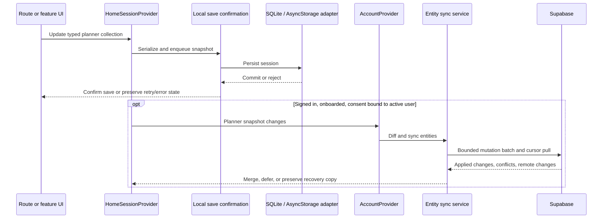

# Data flow

**Reviewed:** 2026-10-27  
**Evidence:** Current local source and checked-in SQL, plus a read-only screenshot of the running app's Progress screen on an iPhone 17 Pro simulator (iOS 26.3). No automated tests, user-flow interaction, provider, remote database, or production deployment was exercised.

Each trace is marked **Verified** when the path is visible in source. Runtime or remote behavior that source cannot establish is marked **Needs Validation**. Performance implications are marked **Inferred**.

## Shared mobile save path

**Verified:** UI setters update shared state; the provider queues a versioned snapshot. `confirmLocalSave()` lets forms wait until the write containing their update completes. Native writes use an exclusive SQLite transaction. Web writes use AsyncStorage. A rejected write is surfaced through storage state and retry controls. See `mobile-app/src/features/home/home-session.tsx`, `local-save-confirmation.ts`, `home-storage.ts`, and `home-storage.web.ts`.

**Verified:** A native session save puts simple session fields, including reminders and settings, in `session_settings`; it deletes and inserts the rows for each saved planner collection inside the transaction. Recovery records and old snapshot/quarantine data are kept separately. The session schema is versioned (current version 9) and normalization accepts prior formats.

**Inferred:** Since each write serializes and rewrites all records in the included collections, write duration and UI save latency may rise with retained data. No timing was collected; see [technical debt](TECHNICAL_DEBT.md).

## Shared daily plan catalog

**Verified in source:** `DailyPlanProvider` starts with the bundled eight-block plan, loads the last valid AsyncStorage cache, then requests `daily-plan` with the public project key. A valid response replaces the cache and is available to onboarding and the routine-template screens. If the request or cache read fails, the bundled plan remains available. The catalog contains shared schedule guidance only; it does not send planner notes, goals, check-ins, commitments, or reflections.

**Verified in source and remote project on 2026-10-31:** `public.daily_plan_catalog` has RLS enabled; only `service_role` has table access. The deployed `daily-plan` Edge Function is active with gateway JWT verification disabled, and a live public `GET` returned HTTP 200 with the seven-day, eight-block plan. The function reads with a server-only service role. `PUT` verifies the caller's Supabase user, checks `dashboard_admins`, validates time ranges and bullet format, and updates only when `expectedRevision` matches; its authenticated administrator path has not been exercised remotely.

**Needs Validation:** The app has not been exercised offline. A newly fetched catalog does not overwrite routines already copied into a person's planner. The migration was applied through the linked CLI SQL query because the remote database has no migration-history table; reconcile migration history before using a broad `db push`.

## Action traces

| User action | Validation and transformation | State and persistence | Error or follow-up behavior | Evidence |
| --- | --- | --- | --- | --- |
| Finish onboarding as Guest | User selects life areas and optional starter goal, style and routine. Selected schedule templates are copied as user schedules. | Onboarding/session values, goals, life areas and schedules go through `HomeSessionProvider` and local save confirmation. Success routes to tabs. | A failed save shows setup feedback and prevents the successful completion route. Guest data is local. | **Verified:** `mobile-app/src/app/index.tsx`; **Needs Validation:** first-install behavior on iOS/Android/web. |
| Link Google or Apple account | Native platform/config checks; OAuth identity token and nonce are exchanged with Supabase. User is asked to choose sync consent; consent is associated with the active user ID. | Supabase session persists via AsyncStorage. Planner remains local unless sync consent is enabled. | Cancel returns no user; unavailable/config errors are surfaced. Sync cannot start before onboarding and consent conditions pass. | **Verified:** `features/account/auth-service.ts`, `supabase-client.ts`, `account-provider.tsx`, `app/index.tsx`; live providers **Needs Validation**. |
| Create/update a task or habit | Name required. Repeat days required for selected-day recurrence. Optional target must be positive and have a unit; progress nonnegative. Task due date must be valid; estimate must be a positive whole number; subtasks need names. Missed-record edits require a reason. | New task/habit creates a definition plus dated occurrence; edits update the definition and/or planned occurrence snapshots. Setters update `taskDefinitions`, `habitDefinitions`, and `entries`. `finishEntrySave()` waits for local persistence. | Field-specific feedback and focus. Save failure retains the draft/pending notice and offers retry. Success clears editor state and shows local-save confirmation. | **Verified:** `features/home/home-screen.tsx` (`addEntry`, `finishEntrySave`). |
| Create/update goal | Name required. Life area must exist and be enabled (unless unchanged on edit); date keys must be valid and target date cannot precede start; quantitative target positive with unit; progress nonnegative; qualitative percentage in 0–100. | Mutates `plans`; meaningful quantitative progress changes append a `goalProgressEvent`. Local save is awaited. | Field-specific form error; save failure leaves edits available for retry. Goal status does not automatically complete when target progress reaches 100 in inspected logic. | **Verified:** `features/home/home-screen.tsx`; progress semantics **Needs Validation** across all entry points. |
| Complete/uncomplete an occurrence | Occurrence status rules determine whether a transition is allowed. A correction reason is recorded for undoing completion or completing after missed. | `setOccurrenceStatus()` updates transition history and `entries`; completed-date tracking is adjusted for the selected date. Provider persists the updated snapshot. | If a terminal transition is disallowed, the domain helper leaves the entry unchanged. The global save banner exposes failed persistence/retry. | **Verified:** `features/home/home-screen.tsx`, `occurrences.ts`, `home-session.tsx`. |
| Reschedule or recover a missed item | A missed item requires a reason; reschedule date must be valid, not before today, and later than the occurrence date. Recovery target must be positive and lower than previous target; replacement habit needs a name. | `rescheduleOccurrence()` creates a linked replacement occurrence, or recovery action updates relevant occurrence/definition. Changes are persisted through session save. | Invalid fields receive validation feedback; persistence errors retain the current recovery edits. | **Verified:** `features/home/home-screen.tsx`, `occurrences.ts`; calendar/time-zone edge cases **Needs Validation**. |
| Save daily check-in | Morning/evening selection determines the record shape. Text values are trimmed; numeric scales are selected through UI controls. The save handler has no separate schema validation call. | Upserts one `checkIns` record keyed by date; awaits local save, then emits a categorical `period` event. | If local save fails, it leaves the sheet open and exposes retry feedback; no success toast/event is emitted until save confirmation. | **Verified:** `features/home/daily-check-in-sheet.tsx`. |
| Save weekly reflection | Form fields are trimmed and a record is keyed by the selected week start. | Replaces any current record for that week in `reflections`; awaits `confirmLocalSave()`, then emits create/update action metadata. | Local save failure leaves the reflection editor open and reports that edits remain. | **Verified:** reflection handler in `features/home/home-screen.tsx`; manual form behavior **Needs Validation**. |
| Save commitment | Requires a non-empty title, positive target, valid deadline, and (when provided) positive whole-number linked action count; may link a goal/task/habit. | Upserts into `commitments`; waits for local save. | Form reports validation or save failure; no separate cloud service is used. | **Verified:** commitment handler in `features/home/home-screen.tsx`. |
| Add goal/habit template | Name required; goal requires first step. Optional target must be positive and have unit. Selected-day habit requires at least one day. | Adds to `plans` or `habitDefinitions`, waits for local save, then emits categorical template metadata. Duplicate source template is not added again. | Validation focuses the invalid field. Failed save preserves pending state and offers retry. | **Verified:** `mobile-app/src/app/template-detail.tsx`. |
| Load or apply the built-in daily plan | The provider accepts only a valid versioned catalog response whose blocks use a time range and bullet-formatted details. | The shared catalog is cached separately in AsyncStorage. Applying a template copies its blocks into the normal local-first `daySchedules` session. | If network access is unavailable, the device uses its last valid cache or bundled default. | **Verified in source:** `features/home/daily-plan-provider.tsx`, `features/home/day-schedules.ts`, `app/day-template-detail.tsx`; offline runtime **Needs Validation**. |
| Apply/edit routine | Routine title, at least one repeat day, and at least one named block. Block target, when present, must be positive and have a unit. | Routine is stored in `daySchedules`; save waits for local confirmation. A later `day-schedules.ts` pass materializes dated routine steps into occurrences. | Invalid routine/block state identifies the editor to correct. Persistence failure keeps the edited schedule and shows retry. | **Verified:** `app/day-template-detail.tsx`, `features/home/day-schedules.ts`. |
| Create reminder | Title is trimmed; time must match 24-hour `HH:mm`; one-off date/time must be valid and future. Daily reminders use a daily trigger. | `reminders` in session state are saved locally first; `syncLocalNotifications()` then cancels/rebuilds app-owned local schedules. | Permission denial, unsupported web, invalid schedule or scheduler error produces status feedback. A local save may succeed even if notification scheduling fails; flow reports the distinct state. | **Verified:** HomeScreen reminder handlers, `features/home/notification-service.ts`; platform delivery **Needs Validation**. |

### Occurrence generation and history

**Verified:** `day-schedules.ts` evaluates recurrence (`daily`, weekdays, weekends, selected days, once) and materializes upcoming task/habit/routine occurrences from definitions. Current rules do not generate historical backfill for old definition dates. `occurrences.ts` reconciles overdue planned entries to missed, deduplicates source/date identities, keeps status transition history, and creates a linked occurrence when rescheduling.

**Verified:** History is derived from occurrences, goal progress events, goal/milestone changes, and related dated records; it is not a separate remote reporting store. **Needs Validation:** Behavior across timezone changes, daylight-saving boundaries, app suspension, date edits, and large histories requires platform/runtime scenarios.

**Verified ordering difference:** `toggleEntry()` captures `planner_item_completion_toggled` before updating the state that will be persisted. Unlike check-in/template/reflection saves, this handler does not await `confirmLocalSave()` before emitting the event. If a subsequent local write fails, analytics may contain a completion signal without a confirmed durable save. This is a source-level consistency risk, not a reproduced data-loss case; see TD-14 in [technical debt](TECHNICAL_DEBT.md).

## Authentication, sync, and recovery

1. **Verified:** `supabase-client.ts` creates a client only when the mobile public URL and publishable key are configured and platform is not web. Auth uses PKCE and persists its session through AsyncStorage.
2. **Verified:** `auth-service.ts` checks platform/build readiness, obtains a native provider token, and exchanges it with Supabase Auth. Apple is iOS-only; Google supports iOS/Android. No email/password flow was found in the reviewed mobile routes.
3. **Verified:** `AccountProvider.syncNow()` returns without syncing unless there is an active user, completed onboarding, affirmative `syncConsent`, and a consent user ID matching that account. It prevents concurrent sync requests and checks network status.
4. **Verified:** A debounced effect triggers sync; reconnect and app-foreground listeners retry. The provider maps results to syncing/synced/offline/conflict/error UI states and structured logs.
5. **Verified:** `entity-sync-service.ts` diffs snapshot entities, maintains pending mutations/version metadata/cursor, submits mutation batches, pulls changes, handles tombstones and creates recovery copies for conflicts. It calls `syncPlannerSnapshot()` for legacy bootstrap/compatibility.
6. **Verified in checked-in SQL:** `sync_planner_mutations` requires `auth.uid()`, validates supported collections, identifiers, versions and timestamps, caps pull pages at 500 and mutation arrays at 100, serializes per-user batches, and returns applied/conflicting mutations plus cursor changes. `planner_entities` has user-scoped read RLS; client writes go through the RPC.
7. **Needs Validation:** Migration deployment, live RLS, two-device merge outcomes, cursor replay, offline retry, account switching, tombstone propagation and actual conflict-resolution UI were not exercised.

The former snapshot protocol remains in `sync-service.ts` and in the `planner_snapshots` table/RPC migration. Current account orchestration calls entity sync, which retains the snapshot code for a legacy bootstrap path. This dual protocol is a source fact; exact production population and upgrade path are **Needs Validation**.

## Account deletion

**Verified in source:** Profile action calls `AccountProvider.deleteCloudAccount()`, which invokes `delete-account`, then clears the local Supabase session. The Edge Function validates the bearer token with an authenticated client and deletes that same user's account using a server-side service role. Errors prevent the client from claiming success.

**Needs Validation:** Function deployment/version, production role permissions, cascaded data removal, legal retention, and any provider/analytics data outside Supabase were not checked.

## Analytics and dashboard flow

- **Verified:** `mobile-app/src/lib/posthog.ts` creates an optional mobile client only when configured. Root screen tracking reports a small static route allowlist; route params are intentionally excluded. Touch and screen autocapture are disabled.
- **Verified:** UI producers send product events for onboarding, planner save/completion, check-ins/reflections, templates, reminder/sync status and recovery. Reviewed payloads contain categorical values/counts/action flags, not planner title or reflection body. Recheck future event call sites.
- **Verified:** `marketing/src/components/MarketingAnalytics.tsx` sends optional page views with autocapture and session replay disabled.
- **Verified:** Dashboard request flow starts with `getDashboardAccess()`: Supabase must be configured, `auth.getUser()` must return a confirmed user, and `dashboard_admins` must contain that user. A server-only data module then requests aggregate PostHog metrics and `dashboard_database_metrics` from Supabase. Missing configuration and query errors yield explicit non-ready page states.
- **Verified in SQL:** Database metrics are aggregated behind the dashboard admin check. **Needs Validation:** Deployed SQL/function behavior, real PostHog query results, environment values and access policy are unverified.

## Offline and error handling

- **Verified:** Guest planner state has local storage independent of cloud services. Cloud sync is conditional and network-aware; its provider represents offline/error/conflict separately.
- **Verified:** Local write acknowledgement has an explicit queued confirmation abstraction and a top-level retry banner; several forms retain their draft and show retryable errors.
- **Verified:** Notification permissions/scheduling are separate from local reminder persistence. Web returns unsupported for OS notifications.
- **Needs Validation:** No network-disconnection, process-kill, storage-full, corrupt-database, airplane-mode or recovery-on-existing-device exercise was run. Therefore the code paths do not establish complete offline durability.

## Evidence limits

The traces above are source-level. They do not prove deployed backend state, provider configuration, successful persistence on supported devices, full accessibility, runtime latency, or end-to-end behavior. The full project findings are in [technical debt](TECHNICAL_DEBT.md) and user-visible map in [feature inventory](../features/FEATURE_INVENTORY.md).
