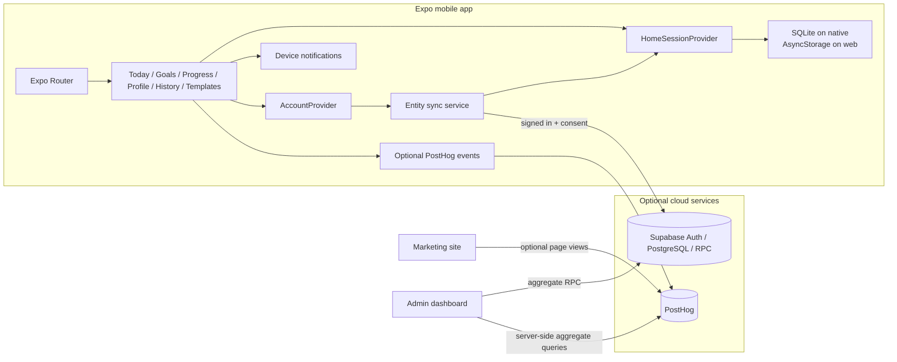

# System overview

**Reviewed:** 2026-10-27  
**Review type:** Read-only source and checked-in configuration review.  
**Scope:** Current local working tree, including uncommitted changes visible at review time. No source, dependency, schema, or configuration files were changed for this review. No build, automated test, user-flow interaction, remote database, analytics provider, or production deployment was exercised. A read-only screenshot was captured from the already running app on an iPhone 17 Pro simulator (iOS 26.3); Android had no attached device.

## Evidence labels

- **Verified** — directly present in reviewed source, manifests, documentation, or checked-in SQL.
- **Inferred** — a likely consequence of the code structure or implementation; no measurement or runtime reproduction was performed.
- **Needs Validation** — requires a device/browser run, deployment inspection, provider check, or operational evidence.

## Product and repository shape

**Verified:** DayKindle is a personal planner for goals, routines, and daily actions. The repository contains three independently packaged applications and a Supabase backend directory. There is no root JavaScript workspace manifest; use each app directory for its package scripts.

| Surface | Location | Main stack | Responsibility |
| --- | --- | --- | --- |
| Mobile planner | `mobile-app/` | Expo SDK `~57.0.25`, React Native `0.86.3`, React `19.2.3`, TypeScript `~6.0.3`, Expo Router | Onboarding, local planner, goals, tasks, habits, routines, progress, history, reminders, optional accounts and sync |
| Public marketing site | `marketing/` | TanStack Start/Router, React `^19.2.0`, Vite 8, Tailwind 4 | Public product, founder, privacy and terms content; optional page-view analytics |
| Private team dashboard | `dashboard/` | Next.js `16.4.0`, React `19.3.0`, Supabase SSR, Recharts | Admin-gated aggregate product and database metrics |
| Backend | `supabase/` | Supabase Auth, PostgreSQL, SQL RPCs, Edge Functions | Per-user planner sync, dashboard authorization and aggregates, account deletion |

**Verified:** Each app has its own package manifest and lockfile. The marketing and dashboard development scripts use ports 3000 and 3001 respectively. **Needs Validation:** Hosting, live project selection, domains, environment values, and production release state are outside this source review.

## Runtime architecture

**Verified:** Mobile state is initialized at the root by `HomeSessionProvider`; `AccountProvider` is nested inside the app content. UI mutations update shared planner state, which is persisted by platform storage adapters. Cloud sync is coordinated separately by the account provider. The dashboard and marketing site are independent deployables.

**Inferred:** `HomeSessionProvider` is the central mobile seam between UI, local persistence, and sync snapshots. This keeps storage details out of most screens, but the shared session surface is broad; see [module map](MODULE_MAP.md) and [technical debt](TECHNICAL_DEBT.md).

## Mobile architecture and local-first model

- **Verified:** `mobile-app/src/app/` defines Expo Router routes and platform-specific tab layouts. Today, Goals, Progress, and Profile route wrappers reuse `features/home/home-screen.tsx`; History has a separate screen.
- **Verified:** `features/home/home-session.tsx` defines the session data model, defaults, normalization and schema migration. The current snapshot schema is version 9, with supported normalization paths for earlier versions.
- **Verified:** Mobile global planner state uses React Context and React state/setter functions in `HomeSessionProvider`; no separate Redux/Zustand-style state package appears in the mobile manifest.
- **Verified:** `features/home/home-storage.ts` uses SQLite (`daykindle-local.db`) on native. It stores collection records in tables and serializes remaining session settings in `session_settings`. `home-storage.web.ts` stores serialized snapshots and recovery records through AsyncStorage. Native startup also reads legacy AsyncStorage snapshots.
- **Verified:** Native SQLite uses WAL and an exclusive transaction for session writes. The write path replaces rows in each planner collection for each snapshot save. JSON is stored in `data_json` for most records.
- **Verified:** `features/home/occurrences.ts` owns occurrence status transitions, terminal-status correction rules, deduplication, rescheduling, and overdue reconciliation. `day-schedules.ts` matches recurrence rules and materializes task, habit, and routine entries.
- **Verified:** Local save confirmation is explicit: `local-save-confirmation.ts` and the provider coordinate queued persistence, resolve successful save requests, and reject failed ones. Forms surface retry/error states.
- **Inferred:** Full collection replacement makes persistence work scale with all stored records rather than only the changed record. No timing or dataset measurements were collected.

## User-facing capability summary

| Capability | Source status | Evidence and boundary |
| --- | --- | --- |
| Onboarding, guest workspace, appearance | **Verified** | `mobile-app/src/app/index.tsx`; life-area selection, optional starter goal/routine, visual style, Guest, Google, and Apple entry points. Provider availability depends on native platform and build configuration. |
| Daily planner, tasks and habits | **Verified** | `features/home/home-screen.tsx`, `day-schedules.ts`, `occurrences.ts`; recurrence definitions produce dated occurrences with completion, missed, skipped, rescheduled, or cancelled states. |
| Goals, milestones and life areas | **Verified** | Goal lifecycle, quantitative or qualitative progress, milestones, and action links are represented in `home-session.tsx` and edited through HomeScreen. |
| Routines and templates | **Verified** | Static catalog in `features/templates/catalog.ts`; schedule and goal/habit template routes. Routine “AI” assistance is prompt/copy/paste plus parsing, not an in-app model request. |
| Check-ins, reflections, commitments | **Verified** | Daily morning/evening check-ins, weekly reflection, and user-defined commitments in HomeScreen and `daily-check-in-sheet.tsx`. |
| Progress and history | **Verified** | Derived summaries and charts plus calendar/day/week history (`use-home-screen-model.ts`, `history-analytics.ts`, `history-screen.tsx`). |
| Reminders | **Verified, bounded** | Local device scheduling through `expo-notifications`; web is unsupported. No push-delivery sender was found in `supabase/functions/`. |
| Account sync | **Verified in source; deployment Needs Validation** | Native Google and Apple sign-in, explicit consent, entity sync and conflict recovery. Supabase is disabled on web. |
| Team dashboard | **Verified in source; deployment Needs Validation** | Confirmed-user and `dashboard_admins` checks precede aggregate PostHog queries and an aggregate database RPC. |
| Budget, transactions or ledger | **Verified absent in reviewed source** | “Finance” appears as a life-area/template category, but no budget or transaction model/flow was found. |

Feature detail and route-to-data traceability are in [feature inventory](../features/FEATURE_INVENTORY.md).

## Dependencies and integration boundaries

**Verified:** Important direct mobile dependencies include Expo/Expo Router, React Native, `@expo/ui`, `expo-sqlite`, AsyncStorage, Expo Notifications, Expo Network, Apple Authentication, `react-native-nitro-google-signin`, Supabase JS, PostHog React Native, Skia, Reanimated/Worklets, Gesture Handler, SVG, and safe-area support. Native modules and Expo config plugins mean package or plugin changes can require a regenerated/rebuilt native client.

**Verified:** Marketing directly uses TanStack Start/Router, Vite, Tailwind, Motion, and PostHog JS. Dashboard directly uses Next.js, Supabase SSR/JS, and Recharts. Runtime dependencies are pinned separately per app; the dashboard and mobile app currently declare different React minor versions.

**Inferred:** Independent app stacks and lockfiles reduce direct runtime coupling but create separate dependency and release surfaces. A cross-app library update can have different compatibility outcomes. Package-level regression risk is summarized in [technical debt](TECHNICAL_DEBT.md).

## Identity, authorization and privacy boundaries

- **Verified:** Mobile Supabase client creation requires configured public URL/key values and is disabled on web (`features/account/supabase-client.ts`). Auth persists through AsyncStorage and is configured for PKCE.
- **Verified:** Native Google and Apple identity tokens are exchanged through Supabase Auth. Google supports iOS/Android; Apple supports iOS. Guest use does not require cloud sync.
- **Verified:** Automatic sync requires a signed-in user, completed onboarding, affirmative sync consent, and a consent user ID matching the active account. Provider code retries after a short debounce, network recovery, and app foregrounding.
- **Verified in checked-in SQL:** Planner entity reads are user-scoped by RLS; entity changes are mediated by `sync_planner_mutations`, a `SECURITY DEFINER` function with an empty search path, auth checks, input bounds, batch/page limits, and per-user transaction locking. The legacy snapshot table has an owner policy and revision-checked save RPC.
- **Verified in source:** The dashboard checks an authenticated, confirmed user and a `dashboard_admins` row. Its database metric RPC is aggregate-oriented, and PostHog credentials are read in a server-only module.
- **Verified in source:** Account deletion invokes the `delete-account` Edge Function, which validates the bearer token before server-side deletion for the caller.
- **Needs Validation:** The migrations and Edge Function may not be deployed; live RLS/RPC behavior, provider setup, deletion completeness, and dashboard membership policy were not queried.
- **Verified in reviewed event calls:** Mobile analytics events use bounded categorical/count properties; the static screen tracker avoids route parameters, and touch/screen autocapture is disabled. Marketing page-view analytics also disables autocapture and session replay. Re-review event payloads when adding instrumentation.
- **Needs Validation:** Device storage protection, actual provider retention, production event settings, and account deletion effects on backups or downstream analytics require platform/deployment inspection.

## Current limitations and operational gaps

- **Verified:** Local reminders are not remote push delivery; a push token helper exists, while the profile text states server delivery still needs connection.
- **Verified:** Routine generation asks the user to use an external AI assistant, copy the result, and paste structured text into the app. There is no model provider request in the reviewed routine helper.
- **Verified:** No source evidence was found for email/password sign-in or mobile web account sign-in in the reviewed flows.
- **Inferred:** A large shared HomeScreen and shared planner context make cross-tab changes harder to isolate and can broaden rendering work. Runtime impact is not measured.
- **Needs Validation:** Platform behavior, accessibility with VoiceOver/TalkBack, offline operation through real network loss, performance at realistic history sizes, migrations on existing installs, and production service health require follow-up.

## Review limits

This document describes the repository snapshot available on 2026-10-27. The worktree was dirty; source conclusions include current working-tree changes, not only the last commit. Checked-in requirements and feature docs are treated as intent unless a matching implementation was found. The screenshot confirms that a native Progress screen rendered in the simulator, but does not prove interaction flows, correctness, or that the installed binary matches this working tree. No existing app data was changed during that observation.
